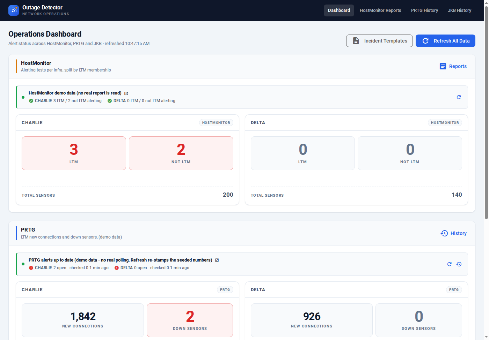
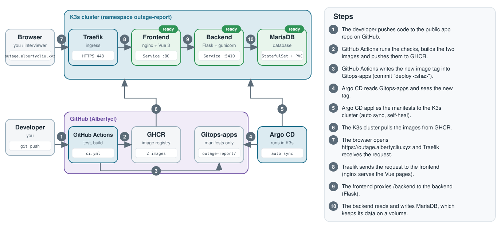

# Outage-report

**Live demo:** https://outage.albertycliu.xyz (made-up data, no login)

A dashboard that tells an on-call engineer in one glance whether anything is on fire, and whether the numbers on screen are still fresh.



## What it does

- Shows alert counts for two example sites (Charlie and Delta) from three kinds of monitoring feeds (HostMonitor, PRTG, JKB: monitoring tools, all simulated here), with history pages.
- Flags a feed as stale when its data is older than 10 minutes. The `/health/*` routes then answer HTTP 503.
- The demo runs on made-up data and the live feeds are off. The repo has no code that calls a real monitoring system. The backend loads fake rows when it starts, and the Refresh buttons only re-stamp those rows. If nobody presses Refresh for a while, the page honestly shows red "STALE" banners.

## How it works



Code goes to GitHub, GitHub Actions builds the images and updates the [Gitops-apps](https://github.com/Albertycl/Gitops-apps) repo, and Argo CD deploys the change to a K3s cluster by itself.

## SRE skills this shows

- **GitOps and CI/CD:** GitHub Actions (test, build, push to GHCR, update Gitops-apps) and Argo CD with auto sync, prune and self-heal.
- **Rollback:** `git revert` of the "deploy" commit in Gitops-apps.
- **Containers:** one Dockerfile per part, container health checks, a non-root backend, Docker Compose.
- **Kubernetes:** Deployments, a MariaDB StatefulSet with a volume, Traefik ingress with a cert-manager certificate, readiness checks, resource requests and limits.
- **Secrets:** created by hand in the cluster, never stored in Git.
- **Health endpoints:** `/health/*` return 503 when data is stale.

## Run it locally

Needs Docker with the Compose plugin.

```bash
cp .env.example .env     # set DB_PASSWORD to any value
docker compose up --build -d
```

Then open `http://localhost:5431`. Stop with `docker compose down`.

## More

[Full details](docs/DETAILS.md): install on Kubernetes, CI/CD, monitoring and known limits.
